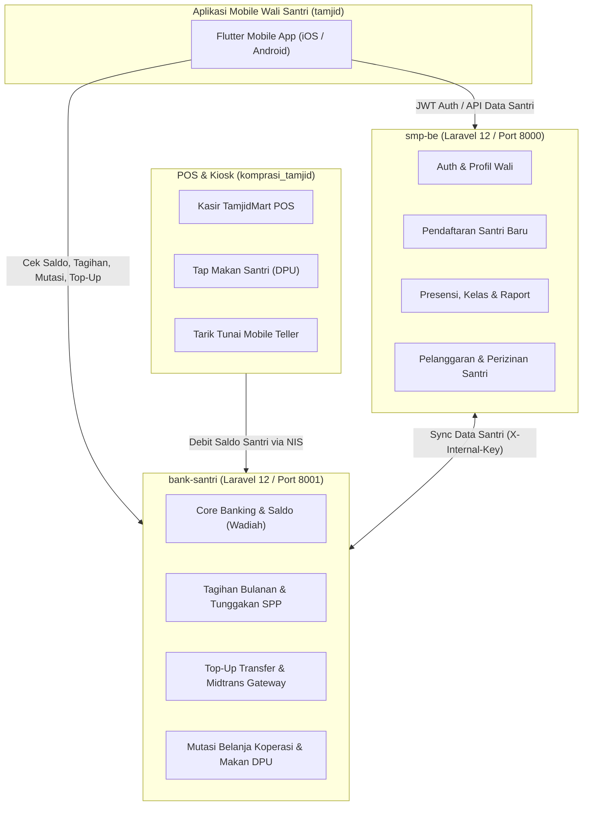

# Dokumen Rencana Kerja & Spesifikasi Pengembangan Aplikasi Mobile Tamjid (Wali Santri)

Dokumen ini merangkum peta jalan (*roadmap*), arsitektur teknis, integrasi sistem, dan spesifikasi fitur aplikasi mobile **Tamjid** yang dirancang khusus untuk wali santri di lingkungan pesantren.

---

## 1. Ringkasan Eksekutif & Tujuan

Aplikasi **Tamjid Mobile** berfungsi sebagai jendela transparansi dan kendali penuh bagi wali santri terhadap seluruh aktivitas, status pendidikan, kedisiplinan, serta perputaran keuangan putra/putri mereka di pondok pesantren.

### Ekosistem yang Terhubung:
* **smp-be (smpt)**: Backend utama akademik, kepengurusan, kesiswaan, perizinan, dan penegakan tata tertib (Kamtib).
* **bank-santri**: Core banking perbankan syariah pesantren, mengelola rekening santri (*NIS as Account Number*), saldo tabungan wadiah, uang saku, tagihan paket SPP bulanan, dan multi-channel top up.
* **komprasi_tamjid**: Aplikasi kasir merchant (TamjidMart POS), gerbang Dapur Umum (DPU), dan kasir Teller Bank Santri tempat santri bertransaksi sehari-hari.
* **smp-fe**: Web portal desktop existing yang menjadi referensi proses bisnis dan alur validasi.

---

## 2. Arsitektur Sistem & Aliran Data



### Kunci Relasi Utama:
1. **Nomor Rekening = NIS Santri (`Account.account_number = Student.nis`)**: Santri tidak memiliki nomor rekening terpisah; seluruh mutasi keuangan santri menggunakan NIS sebagai nomor rekening perbankan.
2. **Akun Multi-Santri (Family Tree)**: Satu akun wali santri (berdasarkan `nik` wali di `parent_profiles`) dapat terhubung ke lebih dari 1 santri (kakak-adik). Aplikasi mobile menyediakan navigasi *switcher* santri yang instan.

---

## 3. Rincian Fitur Utama & Potensi Pengembangan

### A. Autentikasi & Akun Wali
* **Pendaftaran Akun Wali**: Pendaftaran menggunakan nama, email, nomor WhatsApp/telepon, dan kata sandi (`POST /api/auth/register`).
* **Login & Refresh Token**: Login berbasis JWT (`POST /api/auth/login`) dengan persistensi token di Secure Storage dan auto-refresh.
* **Biometric Auth**: Fingerprint / Face ID untuk kemudahan dan keamanan akses harian.
* **Kelola Profil Wali**: Melengkapi dan memperbarui NIK, No. KK, alamat KTP, alamat domisili, pekerjaan, pendidikan terakhir, dan foto profil wali (`POST /api/main/parent/{id}/update-photo`).

---

### B. Dashboard Santri & Family Switcher (Multi-Anak)
* **Family Switcher Bar**: Widget kartu horizontal santri di beranda untuk beralih konteks jika wali memiliki lebih dari 1 anak yang mondok.
* **Kartu Identitas Digital Santri**:
  * Menampilkan foto, nama lengkap, NIS, NISN, status aktif santri.
  * Nama program pendidikan, kamar asrama, dan nama pembina/wali kamar.
  * Barcode / QR Code digital santri untuk verifikasi kunjungan atau penjemputan santri.

---

### C. Keuangan & Dompet Santri (*Core Finance*)
* **Ringkasan Saldo Tabungan & Saku**:
  * Saldo tabungan wadiah santri.
  * Saldo tersedia untuk uang saku harian.
* **Informasi Tagihan & Tunggakan Bulanan (SPP/Paket Pendidikan)**:
  * Integrasi langsung dengan API tagihan `bank-santri` (`GET /api/main/bills/account/{nis}`).
  * Rekap tagihan: status lunas (*paid*), belum lunas (*unpaid*), menunggak (*overdue*), atau beasiswa (*waived*).
  * Detail rincian komponen tagihan (syahriyah/SPP, uang makan, asrama, dll).
* **Riwayat Mutasi & Transaksi Transparan**:
  * Menampilkan catatan transaksi dari kasir Koperasi TamjidMart (pembelian alat tulis, makanan ringan).
  * Menampilkan catatan klaim jatah makan di Dapur Umum (DPU).
  * Menampilkan catatan penarikan tunai santri via Teller Bank Santri.
* **Top-Up Dana Santri (Multi-Channel)**:
  * **Jalur Transfer Bank**: Menampilkan rekening resmi pesantren, form nominal, dan pengunggahan foto struk bukti transfer (`POST /api/main/top-up/bank-transfer`).
  * **Jalur Otomatis (Payment Gateway Midtrans)**: Pilihan Virtual Account (BCA, BNI, BRI, Mandiri) atau QRIS yang langsung diverifikasi secara *real-time* via webhook.
* **Fitur Kontrol Uang Saku (Inovasi Baru)**:
  * Pengaturan batas belanja harian (*Daily Spending Limit*) santri langsung dari aplikasi wali untuk melatih kedisiplinan finansial anak.

---

### D. Pendaftaran Santri Baru (PSB Online)
* **Formulir Pendaftaran Multi-Step (Wizard)**:
  * **Step 1 - Data Wali**: Terisi otomatis (*pre-filled*) dari profil wali yang sedang login.
  * **Step 2 - Biodata Calon Santri**: Nama, tempat/tanggal lahir, jenis kelamin, NIK, alamat tinggal.
  * **Step 3 - Riwayat Sekolah Formal**: Nama sekolah asal, NPSN, jenjang sebelumnya, nomor ijazah.
  * **Step 4 - Riwayat Madrasah / Diniyah**: Lembaga keagamaan sebelumnya (jika ada).
  * **Step 5 - Berkas Dokumen**: Upload foto calon santri, file KK, Akta Kelahiran, dan Ijazah.
* **Pelacakan Status Seleksi & Administrasi**:
  * Status pendaftaran: `Menunggu Berkas`, `Verifikasi Administrasi`, `Ujian Masuk`, `Diterima`, `Ditolak`.
  * Rincian nomor registrasi resmi pesantren.

---

### E. Status Pendidikan & Akademik
* **Informasi Kelas & Kurikulum**: Menampilkan jenjang pendidikan formal/diniyah, nama kelas, kelompok belajar (rombel), dan wali kelas.
* **Jadwal Pelajaran & Kalender Akademik**: Kalender kegiatan belajar mengajar, jadwal ujian, dan waktu kepulangan/libur pesantren.
* **Presensi Santri**: Riwayat kehadiran santri di kelas dan kegiatan ibadah wajib pesantren (`GET /api/main/presence/*`).
* **E-Raport Digital**: Menampilkan rekapitulasi nilai evaluasi belajar berkala dan raport semester (`GET /api/main/report-card/student/...`).

---

### F. Kedisiplinan & Kesantrian (Kamtib & Perizinan)
* **Catatan Pelanggaran & Poin Tata Tertib**:
  * Melihat riwayat pelanggaran santri secara transparan (`GET /api/main/student-violation/student/{studentId}`).
  * Menampilkan tanggal kejadian, kategori pelanggaran, poin hukuman, dan bentuk sanksi pembinaan yang diberikan.
* **Pengajuan & Riwayat Perizinan (Student Leave)**:
  * Melihat riwayat izin keluar/pulang santri lengkap dengan status (*pending*, *approved*, *rejected*).
  * Fitur pengajuan permohonan izin pulang oleh wali (misal: acara keluarga mendesak/sakit) yang diteruskan ke pembina asrama/keamanan.

---

### G. Notifikasi Push Real-Time (FCM)
* Notifikasi instan ke HP wali saat:
  1. Santri belanja di Koperasi atau menarik tunai di Teller.
  2. Terbit tagihan bulanan baru atau mendekati jatuh tempo.
  3. Santri dicatat melakukan pelanggaran oleh bagian Kamtib.
  4. Pengajuan izin santri disetujui atau waktu izin habis.
  5. Pengumuman penting dari pengasuh pondok pesantren.

---

## 4. Matriks Pemetaan API (API Matrix)

| Modul | Endpoint | Method | Service Backend | Keterangan |
|---|---|---|---|---|
| **Auth** | `/api/auth/login` | POST | smp-be | Login wali santri |
| **Auth** | `/api/auth/register` | POST | smp-be | Registrasi akun wali baru |
| **Auth** | `/api/auth/profile` | GET | smp-be | Mengambil data user & profil wali |
| **Auth** | `/api/auth/refresh` | POST | smp-be | Refresh access token JWT |
| **Profil** | `/api/main/parent/{id}/update-photo` | POST | smp-be | Unggah foto profil wali |
| **Anak** | `/api/main/parent/nik/{nik}/cek` | GET | smp-be | Mendapatkan semua santri di bawah NIK wali |
| **Santri** | `/api/main/student/{id}` | GET | smp-be | Detail lengkap santri, kamar, asrama |
| **PSB** | `/api/main/registration` | POST | smp-be | Pendaftaran santri baru multi-step |
| **Keuangan** | `/api/main/account/{nis}` | GET | bank-santri | Cek saldo & informasi rekening tabungan |
| **Keuangan** | `/api/main/bills/account/{nis}` | GET | bank-santri | Rekap tagihan bulanan & tunggakan |
| **Keuangan** | `/api/main/account/{nis}/transactions` | GET | bank-santri | Riwayat mutasi belanja, makan, & tarik tunai |
| **Top-Up** | `/api/main/top-up/bank-transfer` | POST | bank-santri | Pengajuan top up transfer bank manual |
| **Top-Up** | `/api/main/top-up/account/{nis}` | GET | bank-santri | Riwayat pengajuan top up dan status verifikasi |
| **Kamtib** | `/api/main/student-violation/student/{id}` | GET | smp-be | Riwayat pelanggaran santri & sanksi |
| **Perizinan**| `/api/main/student-leave/student/{id}/report`| GET | smp-be | Riwayat perizinan santri |
| **Akademik** | `/api/main/report-card/student/{class}/{id}`| GET | smp-be | Data raport dan nilai evaluasi santri |

---

## 5. Rencana Arsitektur Folder Flutter (`tamjid`)

Pola arsitektur menggunakan **Feature-Driven / Clean Separation** agar skalabel dan mudah diuji:

```
tamjid/lib/
├── core/
│   ├── api/
│   │   ├── api_endpoints.dart         # Konfigurasi URL smp-be & bank-santri
│   │   ├── dio_client.dart            # Dio instance dengan auth interceptors
│   │   └── error_handler.dart         # Standarisasi parsing error API
│   ├── constants/
│   │   ├── app_colors.dart            # Warna tema (Emerald, Slate, Indigo, Amber)
│   │   └── app_assets.dart            # Icon & ilustrasi aset
│   ├── storage/
│   │   └── secure_storage_service.dart# Simpan JWT Token, User Cache, Biometrik
│   ├── theme/
│   │   └── app_theme.dart             # Tema Material 3 konsisten dengan ekosistem
│   └── utils/
│       ├── currency_formatter.dart    # Format Rupiah (Rp xx.xxx)
│       ├── date_formatter.dart        # Format Masehi & Kalender Hijriah
│       └── validators.dart            # Validasi form input
├── models/
│   ├── user_model.dart                # User & ParentProfile
│   ├── student_model.dart             # Student, Hostel, Room, Class
│   ├── bill_model.dart                # Tagihan, Paket, Tunggakan
│   ├── transaction_model.dart         # Mutasi, Saldo, TopUp Request
│   ├── violation_model.dart           # Pelanggaran, Poin, Sanksi
│   └── leave_model.dart               # Izin santri
├── providers/ / blocs/
│   ├── auth_provider.dart             # State login, logout, biometrik
│   ├── student_provider.dart          # State daftar anak & switcher santri aktif
│   ├── finance_provider.dart          # State saldo, mutasi, tagihan, top-up
│   └── academic_provider.dart         # State raport, pelanggaran, perizinan
├── screens/
│   ├── auth/                          # Login, Register, Forgot Password
│   ├── home/                          # Dashboard, Switcher Santri, Quick Actions
│   ├── registration/                  # PSB Form Multi-Step Wizard
│   ├── finance/                       # Saldo Screen, Tagihan, Mutasi, Top-Up Form
│   ├── academic/                      # Info Kelas, Presensi, E-Raport
│   ├── kamtib/                        # Riwayat Pelanggaran & Pengajuan Izin
│   └── profile/                       # Profil Wali, Edit Data, Keamanan
└── widgets/
    ├── app_header.dart                # Header konsisten dengan avatar santri
    ├── student_switcher_card.dart     # Kartu santri aktif
    ├── financial_summary_card.dart    # Kartu saldo & status tagihan
    ├── empty_state.dart               # Tampilan saat data kosong
    └── custom_button.dart             # Tombol interaktif dengan state loading
```

---

## 6. Rencana Pengerjaan Bertahap (Roadmap 5 Sprint)

| Sprint | Durasi | Fokus & Deliverable | Status |
|---|---|---|---|
| **Sprint 1** | Minggu 1 | **Foundation & Auth System**<br>• Setup dependencies (`dio`, `flutter_secure_storage`, `intl`, state management).<br>• Setup Design System & Theme Material 3.<br>• Halaman Splash, Login, Register Wali, dan Profil Wali. | Siap Dimulai |
| **Sprint 2** | Minggu 2 | **Data Santri & PSB Wizard**<br>• Fetch data santri berdasarkan NIK wali (`/parent/nik/{nik}/cek`).<br>• Implementasi Multi-Santri Switcher di Dashboard.<br>• Implementasi Form Wizard Pendaftaran Santri Baru (PSB). | Terjadwal |
| **Sprint 3** | Minggu 3 | **Modul Keuangan & Top-Up**<br>• Integrasi saldo & informasi rekening dari `bank-santri`.<br>• Tampilan tagihan bulanan (SPP) & rincian tunggakan.<br>• Riwayat mutasi lengkap (Koperasi, DPU, Teller).<br>• Form Top-Up Transfer Bank & integrasi Midtrans. | Terjadwal |
| **Sprint 4** | Minggu 4 | **Modul Pendidikan & Kedisiplinan**<br>• Tampilan catatan riwayat pelanggaran & sanksi santri.<br>• Tampilan dan pengajuan perizinan santri (Student Leave).<br>• Informasi asrama, kamar, dan raport akademik. | Terjadwal |
| **Sprint 5** | Minggu 5 | **Pengayaan Fitur, Notifikasi & Rilis**<br>• Kartu Santri Digital ber-QR Code.<br>• Integrasi Push Notification Firebase (FCM).<br>• Uji integrasi end-to-end, error handling offline, dan optimasi build rilis (Android APK / iOS). | Terjadwal |

---

## 7. Dependencies Rekomendasi di `pubspec.yaml`

```yaml
dependencies:
  flutter:
    sdk: flutter
  cupertino_icons: ^1.0.8

  # Networking & Auth
  dio: ^5.7.0
  flutter_secure_storage: ^9.2.2
  shared_preferences: ^2.3.3

  # State Management
  provider: ^6.1.2 # atau flutter_bloc: ^8.1.6

  # Formatting & Localization
  intl: ^0.19.0

  # UI Enhancement & Feedback
  cached_network_image: ^3.4.1
  flutter_svg: ^2.0.14
  fl_chart: ^0.69.0 # Untuk grafik belanja santri
  qr_flutter: ^4.1.0 # Untuk QR Kartu Santri
  image_picker: ^1.1.2 # Upload struk transfer & berkas santri
  local_auth: ^2.3.0 # Biometrik login
  shimmer: ^3.0.0 # Skeleton loading
```
